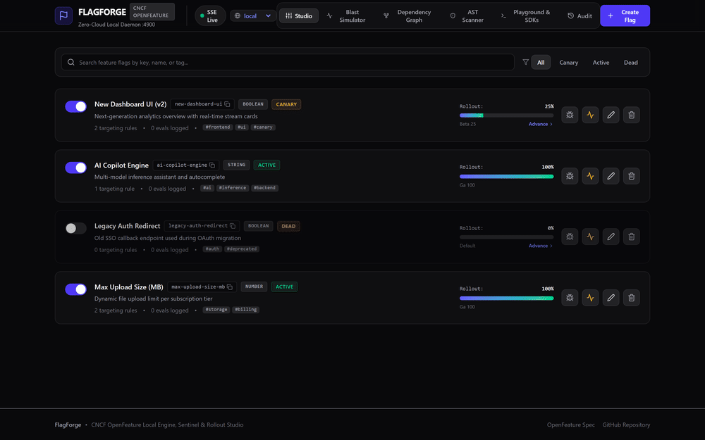
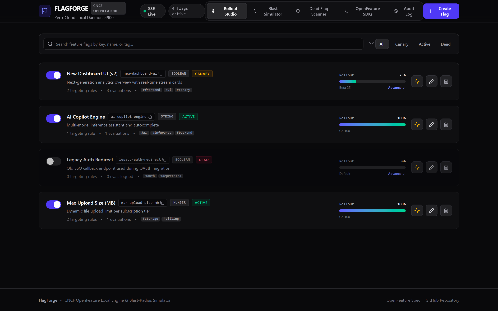
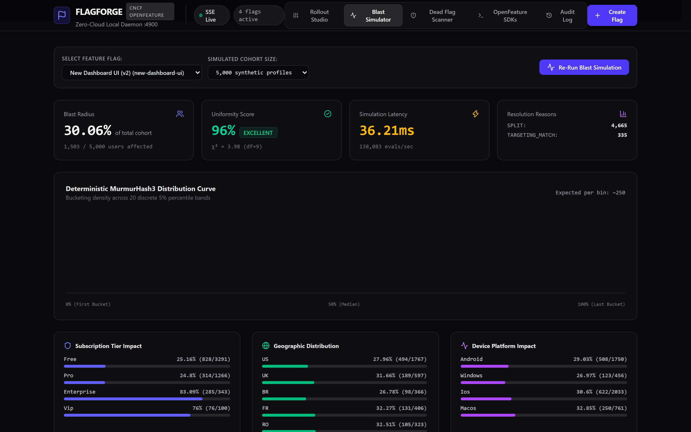
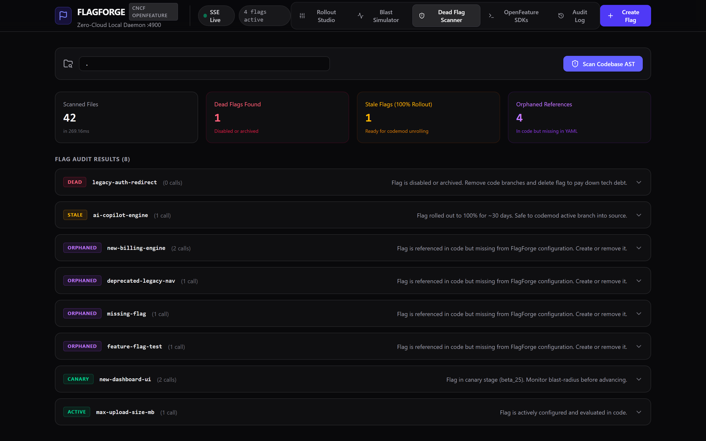

<div align="center">

# FlagForge

**OpenFeature-compliant local feature flag engine, blast-radius simulator, and dead flag AST scanner.**

[](https://github.com/alexandrmotologa/flagforge/actions/workflows/ci.yml)
[](https://openfeature.dev)
[](https://www.typescriptlang.org)
[](https://react.dev)
[](https://nodejs.org)
[](https://opensource.org/licenses/MIT)

<br />



</div>

---

## Overview

Commercial feature flagging platforms introduce network latency and subscription fees that complicate local development. Teams frequently resort to hardcoded boolean flags, creating merge conflicts and rollout surprises.

FlagForge provides a self-contained, zero-cloud feature flag daemon for local machines and private environments. It implements the CNCF OpenFeature provider specification and the OpenFeature Remote Evaluation Protocol (OFREP), runs targeting simulations against synthetic user cohorts, and scans codebase ASTs to unroll retired flags automatically.

## Key Capabilities

- **100% OpenFeature Compliant**: Operates as a provider for official OpenFeature SDKs across Node.js, React, Python, Go, and Java.
- **Zero-Cloud Local Daemon**: Evaluates flags with sub-millisecond local latency, storing state in human-readable YAML (`flagforge.config.yaml`) and tracking evaluations in an embedded SQLite database.
- **Blast-Radius & Targeting Simulator**: Runs candidate rollout rules against synthetic cohorts (1,000 to 50,000 profiles) across geographic distributions, subscription tiers, and device platforms, computing statistical Chi-Square goodness-of-fit scores.
- **Dead Flag & Tech Debt Scanner**: Scans JavaScript and TypeScript ASTs to detect retired flags and generates automated branch-unrolling codemods with diff previews.
- **Rollout Studio UI**: Dark-mode web interface built on React 19 and Tailwind CSS with real-time Server-Sent Events (SSE) updates.

---

## User Interface

### Rollout Studio & Canary Progression
Manage flag configurations, adjust percentage sliders, and advance canary stages (Internal -> Canary 5% -> Beta 25% -> Staged 50% -> GA 100%).



### Blast-Radius Cohort Simulator
Visualize MurmurHash3 distribution curves across synthetic populations and review impact matrices by tier, country, and platform before deploying changes.



### Dead Flag AST Scanner and Codemod
Identify stale flag usages in your source tree and apply automated AST refactoring with backup preservation.



---

## Quickstart

### 1. Install Dependencies and Build

```bash
git clone https://github.com/alexandrmotologa/flagforge.git
cd flagforge
npm install
npm run build
```

### 2. Start the Daemon and Studio

```bash
# Starts the HTTP daemon and web interface on port 4900
npm start

# Or run via CLI directly:
node bin/flagforge.js start -p 4900
```

Open `http://localhost:4900` in your browser to view the Rollout Studio.

---

## OpenFeature SDK Integration

FlagForge works directly with official OpenFeature SDKs without proprietary vendor lock-in.

### Node.js / TypeScript (`@openfeature/server-sdk`)

```typescript
import { OpenFeature } from '@openfeature/server-sdk';
import { FlagForgeProvider } from 'flagforge/provider';

// Configure FlagForge local provider
await OpenFeature.setProviderAndWait(
  new FlagForgeProvider({ daemonUrl: 'http://localhost:4900' })
);

const client = OpenFeature.getClient();

// Evaluate flag using OpenFeature API
const isV2Dashboard = await client.getBooleanValue(
  'new-dashboard-ui',
  false,
  {
    targetingKey: 'usr_enterprise_77',
    email: 'developer@flagforge.dev',
    tier: 'enterprise',
    country: 'MD',
  }
);
```

### React (`@openfeature/react-sdk`)

```tsx
import { useFlag } from '@openfeature/react-sdk';

export function Dashboard() {
  const { value: isV2 } = useFlag('new-dashboard-ui', false);

  return isV2 ? <ModernDashboardView /> : <LegacyDashboardView />;
}
```

### Python (`openfeature-sdk`)

```python
from openfeature import api
from openfeature.contrib.provider.ofrep import OFREPProvider

api.set_provider(OFREPProvider("http://localhost:4900/ofrep"))
client = api.get_client()

is_enabled = client.get_boolean_value(
    "new-dashboard-ui",
    False,
    {"targeting_key": "usr_77", "tier": "enterprise"}
)
```

### Standard CNCF OFREP Endpoint (cURL)

```bash
curl -X POST http://localhost:4900/ofrep/v1/evaluate/flags/new-dashboard-ui \
  -H "Content-Type: application/json" \
  -d '{
    "context": {
      "targetingKey": "usr_77",
      "email": "engineer@flagforge.dev",
      "tier": "enterprise",
      "country": "MD"
    }
  }'
```

---

## CLI Reference

FlagForge includes a command line interface for evaluations, simulations, and codebase maintenance:

```bash
# Evaluate a flag from terminal
flagforge eval new-dashboard-ui --context '{"userId":"usr_1","tier":"enterprise"}'

# Simulate blast radius across 10,000 synthetic profiles
flagforge simulate new-dashboard-ui --size 10000

# Scan codebase AST for dead, stale, and orphaned flags
flagforge scan ./src

# Run AST codemod to unroll flag branches into source code
flagforge codemod ./src/feature.ts --flag new-dashboard-ui --resolve true --apply

# Export flag definitions to CNCF flagd format
flagforge export -f flagd
```

---

## Configuration (`flagforge.config.yaml`)

Flag definitions reside in a local YAML configuration file with live file-watching:

```yaml
version: "1.0.0"
metadata:
  environment: local-development
flags:
  new-dashboard-ui:
    name: New Dashboard UI (v2)
    type: boolean
    enabled: true
    defaultValue: false
    defaultVariant: "off"
    variants:
      "on": true
      "off": false
    rules:
      - id: internal-staff
        description: Enable for company accounts
        conditions:
          - property: email
            operator: matches_regex
            value: ".*@(flagforge\\.dev|company\\.com)$"
        serve:
          variant: "on"
    rollout:
      percentage: 25
      stickinessProperty: userId
      salt: dash_salt_2026
    canaryStage: beta_25
    lifecycle: canary
```

---

## Testing

FlagForge maintains an automated Vitest test suite covering hash distribution uniformity, rule evaluation, OFREP formatting, AST parsing, and codemod unrolling.

```bash
# Run unit and integration tests
npm test
```

---

## Architecture & Standards

Detailed architectural documentation and CNCF compliance guides are available in the `docs/` directory:

- [Architecture Design & Pipeline](docs/ARCHITECTURE.md)
- [OpenFeature & OFREP Specification Details](docs/OPENFEATURE_SPEC.md)

---

## License

MIT License. Designed and maintained by Alexandr Motologa.
